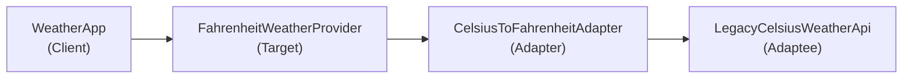
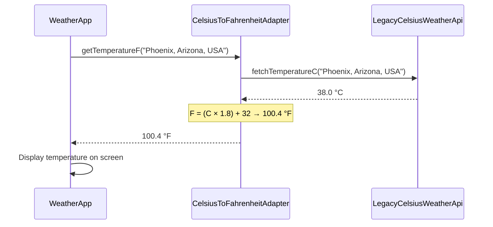

# Adapter Design Pattern

The **Adapter** pattern is a structural pattern that lets classes work together that could not otherwise because of incompatible interfaces. It wraps an existing class (the **adaptee**) and exposes the interface the rest of your application expects (the **target**).

## Key Idea

Your app expects one interface (`FahrenheitWeatherProvider` here). A legacy third-party service uses a different interface (`LegacyCelsiusWeatherApi`). The **adapter** sits in the middle: it calls the legacy API, translates the data (Celsius → Fahrenheit), and returns what the app needs. The app never has to know about Celsius.

We cannot change the Weather App or the legacy API — so the adapter bridges the gap. It fixes **two mismatches**: different method names (`getTemperatureF` vs `fetchTemperatureC`) and different units (°F vs °C).

## When to Use

- Integrate a third-party or legacy API without rewriting your main application.
- Make two incompatible interfaces work together (different method names, data formats, or units).
- Reuse existing code when you cannot modify the original class or service.
- Keep client code simple — callers only depend on the target interface they already know.

## How It Works (Weather App Demo)

The Weather App only understands Fahrenheit. The legacy third-party API only returns Celsius. The adapter sits in the middle and translates between them.



When you pick a city, the demo walks through this flow step by step:


Sequence Diagram:



| Role | Class | What it does |
| ---- | ----- | ------------ |
| **Client** | `WeatherApp` | Asks for weather in Fahrenheit and displays the result |
| **Target** | `FahrenheitWeatherProvider` | Interface the app expects: `getTemperatureF(city)` |
| **Adapter** | `CelsiusToFahrenheitAdapter` | Calls the legacy API, converts Celsius → Fahrenheit |
| **Adaptee** | `LegacyCelsiusWeatherApi` | Old third-party API that only returns Celsius |

## Example: Weather App

- **`FahrenheitWeatherProvider`** (Target) — interface the app expects: `getTemperatureF(city)`.
- **`LegacyCelsiusWeatherApi`** (Adaptee) — old third-party API that only returns Celsius via `fetchTemperatureC(city)`.
- **`CelsiusToFahrenheitAdapter`** (Adapter) — implements `FahrenheitWeatherProvider`, calls the legacy API, converts C → F using `(C × 1.8) + 32`.
- **`WeatherApp`** (Client) — the Fahrenheit weather app; uses the provider interface and never touches the legacy API directly.
- The demo walks through each step (Client → Target → Adapter → Adaptee → conversion → result). Pick a city (Phoenix Arizona USA, London England UK, or Tokyo Japan) and press **Enter** at each step. Optionally compare what happens **without** the adapter — the app would mislabel Celsius as Fahrenheit.

## How to Run

```bash
cd adapter-design-pattern
npm install
npm run dev
```

Pick a city, then press **Enter** to start and at each step. Optionally view the broken display without the adapter. When finished, type **continue** to pick another city or **exit** to quit.
