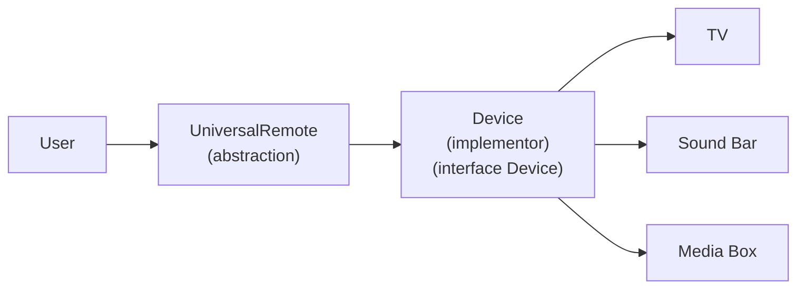

# Bridge Design Pattern

The **Bridge** pattern is a structural pattern that **decouples an abstraction from its implementation** so the two can vary independently. The high-level feature (what you do) stays separate from the low-level details (how it gets done).

## Key Idea

Define an abstraction (`UniversalRemote`) that holds a reference to an implementor (`Device`). The remote exposes the same physical buttons (power, UP, DOWN, LEFT, RIGHT). Each device implements those actions in its own way. The same remote works with a TV, sound bar, or media box without subclassing every combination (`TvRemote`, `SoundBarRemote`, etc.).

## Universal Remote (Abstraction)

The demo maps terminal commands to buttons on one universal remote. **UP / DOWN** always adjust volume. **LEFT / RIGHT** mean something different on each device — that is the bridge in action.

```
                    ┌─────────┐
                    │  POWER  │
                    └─────────┘

              ┌─────┬─────┬─────┐
              │  1  │  2  │  3  │   <- device input (TV, Sound Bar, Media Box)
              └─────┴─────┴─────┘

                    ┌─────────┐
                    │   UP    │   volume +
                    └─────────┘

    ┌─────────┐     ┌─────────┐     ┌─────────┐
    │  LEFT   │     │         │     │  RIGHT  │
    └─────────┘     └─────────┘     └─────────┘
    device-specific  (center)       device-specific

                    ┌─────────┐
                    │  DOWN   │   volume -
                    └─────────┘
```


| Button        | TV                        | Sound Bar         | Media Box         |
| ------------- | ------------------------- | ----------------- | ----------------- |
| **POWER**     | on / off                  | on / off          | on / off          |
| **UP**        | volume +1                 | volume +5         | volume +10%       |
| **DOWN**      | volume −1                 | volume −5         | volume −10%       |
| **LEFT**      | channel − (channels 1–10) | input − (HDMI)    | previous title    |
| **RIGHT**     | channel + (channels 1–10) | input + (HDMI)    | next title        |
| **1 / 2 / 3** | connect TV                | connect Sound Bar | connect Media Box |


Always available: `switch input` (change device) and `quit`.

All devices start at volume **15** and can be adjusted from **0** to **100** using UP / DOWN.

## How It Works (Universal Remote Demo)

You pick a device input. The same remote buttons send commands — but each device responds differently.




| Step | Side               | What happens                                                                          |
| ---- | ------------------ | ------------------------------------------------------------------------------------- |
| 1    | **Abstraction**    | You pick a device input; `UniversalRemote` is created with that `Device` plugged in   |
| 2    | **Bridge**         | You press **UP** — the remote delegates to the device without knowing device details  |
| 3    | **Implementation** | `TV` raises volume by 1, `SoundBar` by 5, `MediaBox` by 10%                           |
| 4    | **LEFT / RIGHT**   | Same button, different behavior: channel vs. HDMI input vs. next/previous title       |
| 5    | **Runtime swap**   | Type `switch input` — `setDevice()` plugs in a new device; remote code stays the same |


## When to Use

- Both the high-level feature and the low-level platform can change over time.
- You want to swap implementations at runtime (e.g., plug in a different device).
- Inheritance would create too many subclasses for every abstraction + implementation pair.
- You want to test the abstraction with a fake or console implementation.

## Example: Universal Remote

- `Device` — the implementor interface (`upButton`, `downButton`, `leftButton`, `rightButton`, plus status).
- `TV`, `SoundBar`, `MediaBox` — concrete implementors; LEFT/RIGHT do channel, input, or title navigation.
- `UniversalRemote` — the abstraction; delegates button presses to whichever `Device` is plugged in.
- The demo lets you pick a device input, then send commands from the same remote.

## How to Run

```bash
cd bridge-design-pattern
npm install
npm run dev
```

Pick a device input (1–3), or press Enter to start with no device. The prompt shows `UniversalRemote [ TV ]>` (or `Device not selected`). Commands: `power`, `up`, `down`, `left`, `right`, `switch input`, `quit`. You can also type `1`, `2`, or `3` to connect a device. Device status and button mapping are shown before each prompt.