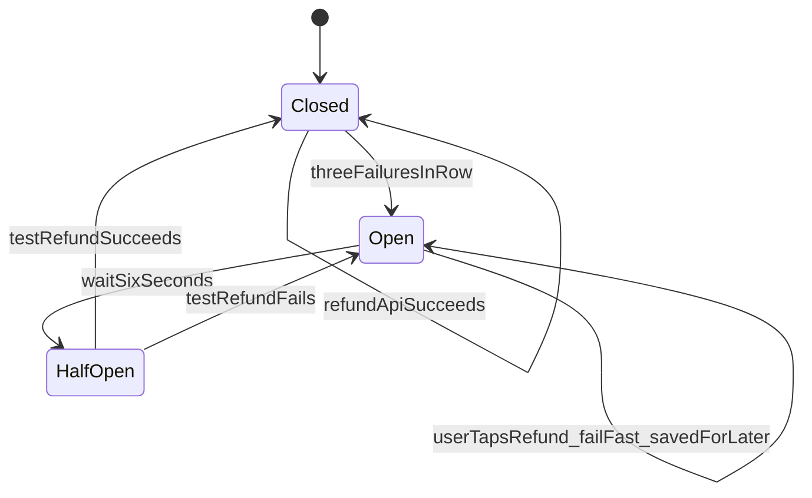

# Circuit Breaker Design Pattern

The **Circuit Breaker** pattern protects your app from a failing dependency (like a remote API). It watches for repeated failures, then **stops calling** the broken service for a while so you fail fast instead of hanging on every request.

## Key Idea

Wrap a protected call (here, a Walmart+ refund API call) in a **circuit breaker** object. The breaker has three states:

- **Closed** — Normal. Calls go through to the remote API.
- **Open** — Too many failures. Calls are blocked immediately (no remote call). Your refund request is saved for later.
- **Half-Open** — After a wait period, one test call is allowed to see if the API recovered.

Think of it like an electrical circuit breaker: it trips when things go wrong, then can be tested again later.

## How It Works (Walmart+ Refund Demo)

You ordered groceries. **Milk was missing.** You tap **Request refund** — but the refund system is down.




| Step          | Circuit                 | What happens                                            |
| ------------- | ----------------------- | ------------------------------------------------------- |
| 1–3           | **Closed**              | App calls refund API — system is down, slow errors      |
| *(after 3)*   | **Open**                | Third failure trips the breaker                         |
| *(wait)*      | **Half-Open**           | 6 seconds pass between steps 3 and 4                    |
| 4             | **Half-Open → Closed**  | Test refund succeeds — refund approved                  |


## When to Use

- Remote calls that can fail, hang, or time out (APIs, payment gateways, databases).
- You want to prevent one slow service from taking down your whole system.
- You need fast fallback responses when a dependency is known to be unhealthy.
- You want to give a struggling server time to recover instead of hammering it with more requests.


## Example: Walmart+ — Missing Grocery Refund

- `CircuitBreaker` — Wraps `processRefundRemote()` and tracks failures, state, and reset timing.
- `processRefundRemote()` — Simulated refund API that fails on a simple scripted schedule.
- `requestRefund()` — App code that calls through the breaker; when open, saves the request and responds instantly.
- The demo shows one missing item (Milk). Press Enter for each of 4 refund attempts and watch closed → open → half-open → closed.


## How to Run

```bash
cd circuit-breaker-pattern
npm install
npm run dev
```

Press **Enter** before each refund attempt. Watch for slow API waits (closed), the circuit opening after the third failure, the automatic wait into half-open, and the final approved test refund (half-open → closed).

## Reference

- [Martin Fowler — Circuit Breaker](https://martinfowler.com/bliki/CircuitBreaker.html)

